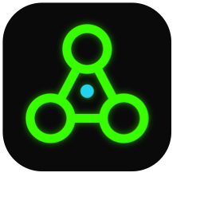

# agent-neuron demos



Demos of [agent-neuron](https://github.com/overfocus/agent-neuron)'s **decision
surface**: agents do the work, the network file holds the team's rules, and
people decide on the engine's desk, each with their own link, with every
answer recorded with who and why. Watch any of them in 3D with
[agent-neuron-viz](https://github.com/overfocus/agent-neuron-viz).

**Try it in one line** (needs Node 22, git and [Rust](https://rustup.rs); run it in an empty folder):

```sh
git clone https://github.com/overfocus/agent-neuron-demos && cd agent-neuron-demos && npm run setup && npm run watch colony
```

`setup` fetches the engine and the 3D viewer next to this repo and builds
them; `watch` starts the viewer, opens a page with the network in 3D and
every person's desk, and runs the demo. Swap `colony` for `quorum`,
`backlog`, `spend`, `refunds` or `oncall`. More in
[GETTING-STARTED.md](GETTING-STARTED.md), with a shot list per demo for
recording them.

Everything here is invented: the people (Ada, Lin, Sam, Kit), the harbour
booking app, the patches, the refunds. The agents are small scripts that
return canned work. The decisions about that work are real: they are made on
the engine's desk, checked against the run's grants, and recorded on its
stderr and in its trace.

## The demos

| Demo | What it shows |
|---|---|
| `quorum` | Two agent branches in a scratch git repo. Both reviewers choose on the desk; a threshold-2 join hears them together; the lead's gate drives a real `git merge` (an effect). A reviewer who tries to answer the lead's gate is refused. `--tie`: a split goes to the lead, whose No merges nothing. |
| `backlog` | A week for a team of three: **15 bugs, 5 requirements, 2 architecture changes**. The house rules are a data file, not prompt context: clean fixes land on their own; a dependency nobody chose (a lock-in) or a second config system (slop) goes to the lead with the findings. Requirements need both ICs to accept the agent's acceptance criteria. Architecture changes get both ICs' advice, the lead's call, and a written decision record either way. A P4 bug runs on a lowered budget and its fix is refused. |
| `spend` | An agent and a critic in a loop, under a credit ceiling per task. The spend report goes to the manager on the desk; the answer becomes a `policy.json` diff, and round 2 runs under the new ceiling. |
| `refunds` | Paying is an effect. Large refunds wait for a person. A resubmitted request mid-payment does not cut the payment; its answer is recorded but not forwarded, and the duplicate returns the first payment's result. A payment that crashes after the money moved is `unknown`, and a reconcile run asks the ledger. |
| `oncall` | A decision that goes stale before it is made: a newer alert for the same service withdraws the waiting ask from the desk, the late answer is refused, and the new ask takes its place. |
| `colony` | *n* ants, food and a nest, with no one in charge. Each ant is its own long-lived neuron with its own response threshold; it forages when the colony is hungry enough for it, and follows trails in proportion to their pheromone. The nest alone writes the ground (pheromone, hunger); time evaporates it. The nearest food runs out and a new patch appears: watch the traffic move. |

## Run them

You need Node 22 and the [agent-neuron](https://github.com/overfocus/agent-neuron)
checkout next to this one (or `AGENT_NEURON_ROOT`). The engine is built with
`cargo` the first time, so you also need a Rust toolchain.

```sh
git clone https://github.com/overfocus/agent-neuron
git clone https://github.com/overfocus/agent-neuron-demos
cd agent-neuron-demos

npm run demo                          # the list
npm run demo quorum                   # prints a desk link per person: open them, decide
npm run demo quorum -- --headless     # the invented people answer through the same desk API
npm run demo backlog -- --headless
npm run demo colony -- --ants 40 --seconds 60
npm run demo backlog -- --headless --pace 3   # watchable speed, for recording
npm run stage                         # one page to record from: the 3D view and every desk
npm test                              # every demo headless, its outcome asserted
```

Each run writes its trace, its stream and its stderr under `runs/<demo>/`.

### Watching in 3D

With [agent-neuron-viz](https://github.com/overfocus/agent-neuron-viz) checked
out next to this repo:

```sh
cd ../agent-neuron-viz && npm install && npm run dev
# open http://localhost:5180/?attach, then run any demo here
```

The viewer follows `runs/current.json`, which every demo updates. It draws
the network as soon as a run starts, plays the events as they happen, makes
a human neuron breathe while the desk waits on a person, and replays the
whole trace when the run ends.

## How a demo is built

- `demos/<name>/<name>.network.json`: the network: neurons, links, budget,
  costs, effects, thresholds. Checked by `neuron-engine check`.
- `demos/<name>/*.grants.json`: who sits at the desk, their roles, and which
  human neurons each may answer (agent-neuron decision 0010).
- `demos/<name>/neurons/`: the programs, one small file each.
- `demos/<name>/demo.mjs`: the inputs, the run, the narration, the
  `--headless` people, and the report.
- `lib/`: the shared harness: `run.mjs` starts the engine and tails its
  stream, `desk.mjs` is the desk client the headless people use (the same
  `GET /state` and `POST /answer` a person's page makes), `narrate.mjs`.

## What is not built

These are the open items in agent-neuron's
[MULTIPLAYER.md](https://github.com/overfocus/agent-neuron/blob/main/docs/MULTIPLAYER.md):
the desk's state dies with the run (no async table yet); presence is the page
only (no pings); a pool can be lowered only when a trace is injected, not
while it runs; and a run's "settled" moment has no trigger of its own.

## License

MIT.
